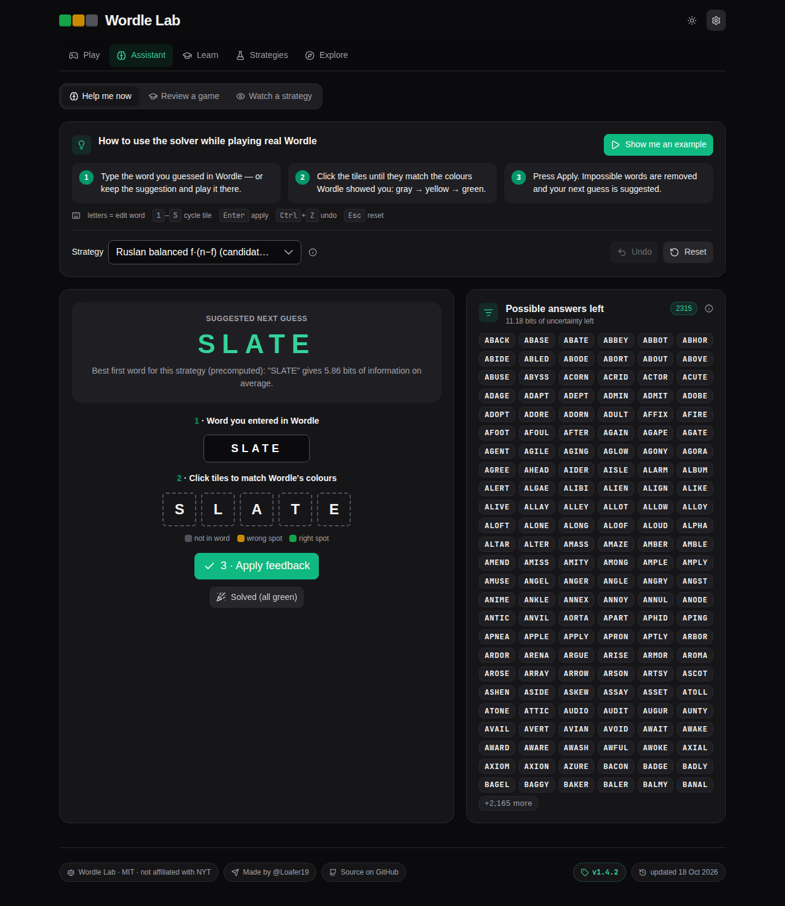
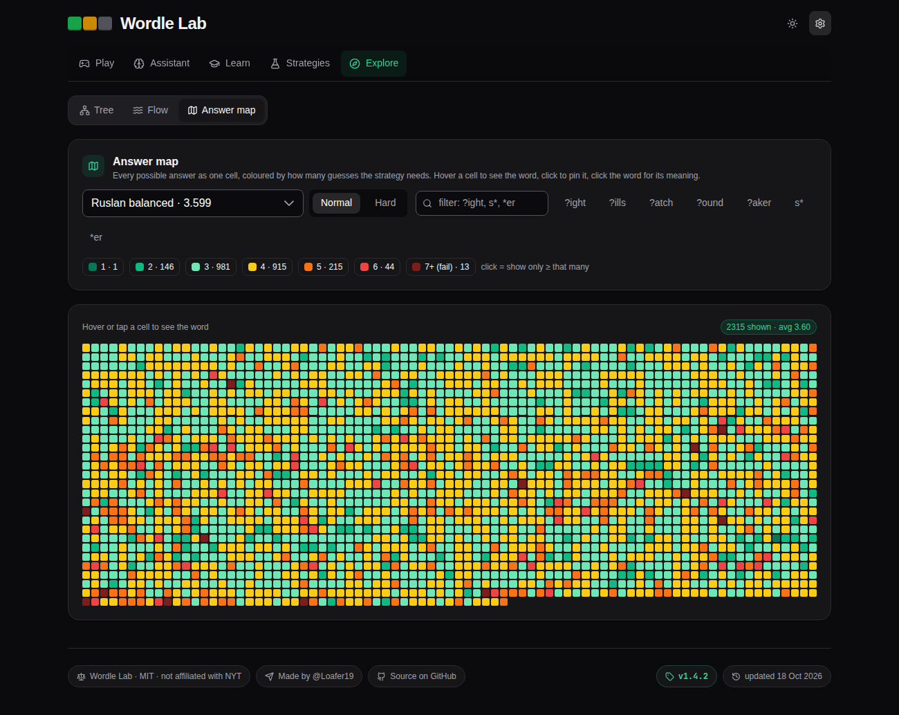
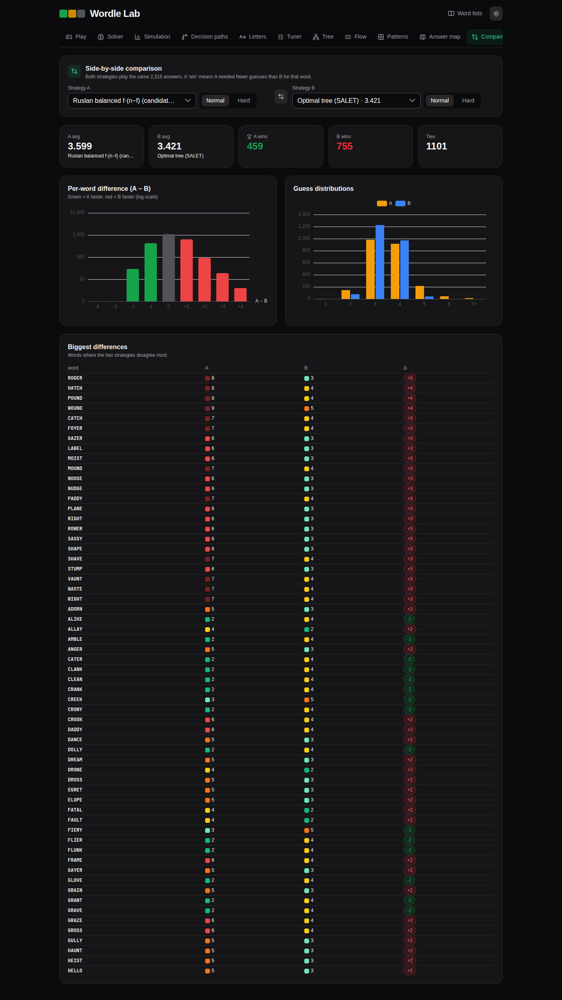
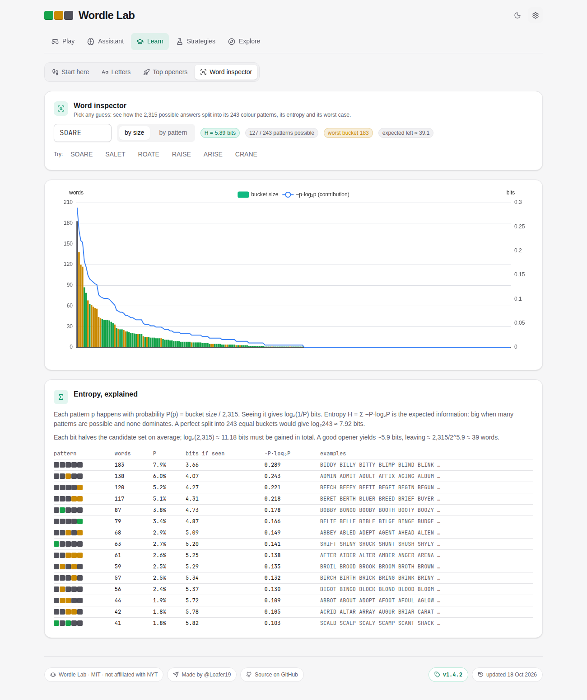
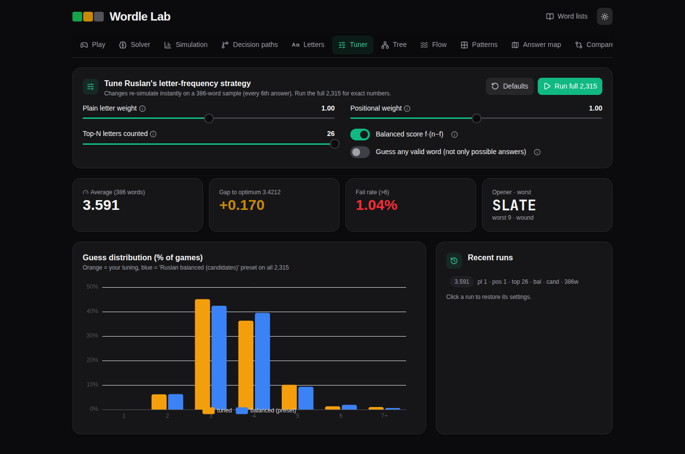
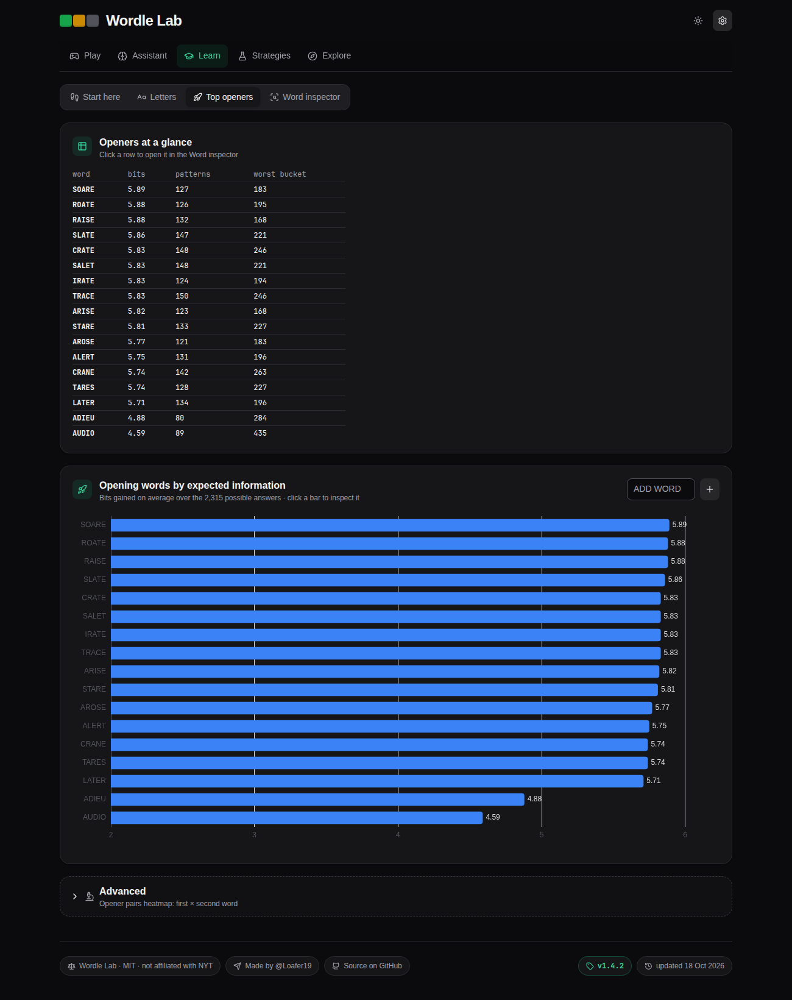

<div align="center">

# 🟩🟨⬛ Wordle Lab

**Play Wordle, get a solver that explains every guess, and see how 13 strategies compare across all 2,315 answers.**

[](https://wordle.fundsflow.fun)
[](LICENSE)
<br/>


</div>

## ✨ Features

| | |
|---|---|
| 🎮 **Play** | Daily word with a countdown to the next one, or random games. Hard mode, flip, bounce and confetti animations, stats, a shareable emoji grid, and the **word's meaning** after each game. |
| 🧭 **Solver** | Type your guess, tap the tiles to match your colours, and get the next best word with a plain-English reason. Undo, a demo mode, keyboard shortcuts, and the provably optimal tree. |
| 🧪 **Strategies** | **Simulation** of every strategy on every answer (Web Workers), a head-to-head **Compare**, and a live **Tuner** for the letter-frequency heuristic. |
| 🧭 **Explore** | **Decision paths** for any secret word, the optimal decision **Tree**, a **Flow** sankey of how the answer set shrinks, and an **Answer map** of how hard each word is. |
| 🔤 **Letters & Patterns** | Letter frequencies, all 243 colour patterns with the entropy maths, and the best **Openers**, including a heatmap of opener pairs. |
| 🇺🇦 **Ukrainian** | EN/UA switch in Settings: Ukrainian word lists, a ЙЦУКЕН keyboard (ґ, є, і, ї), and every strategy simulated on Ukrainian answers. |
| 📖 **Word meanings** | Click any word for its definition (dictionaryapi.dev with Wiktionary as a fallback; UA words link to Горох, СУМ-20 and sum.in.ua). |

Every tab and sub-view is a real link, e.g. `#tab=explore&view=tree`, so you can open views in new tabs and share them.

<table>
<tr><td></td><td></td></tr>
<tr><td></td><td></td></tr>
<tr><td></td><td></td></tr>
<tr><td></td><td></td></tr>
</table>

## 🏁 Strategy results (all 2,315 answers, normal mode)

| Strategy | Avg guesses | Failures (>6) | Idea |
|---|---:|---:|---|
| **Optimal tree (SALET)** | **3.4212** | 0 | Alex Selby's proven-optimal decision tree |
| Two-step entropy | 3.446 | 0 | Maximise the information from this guess *and* the best next one |
| Entropy (any word) | 3.465 | 0 | Maximise the expected information (bits) |
| Expected size | 3.481 | – | Minimise the expected number of answers left |
| Minimax | 3.573 | – | Minimise the worst-case group size |
| Ruslan balanced f·(n−f) | 3.599 | 0.56% | Letter frequency weighted f·(n−f) |
| Entropy (candidates only) | 3.599 | – | Entropy, but only guessing possible answers |
| Ruslan positional | 3.622 | – | Letter frequency per position |
| Ruslan freq | 3.684 | – | Plain letter frequency |
| Random candidate | 4.091 | – | Baseline |

Hard mode: optimal 3.5084, two-step 3.553, entropy 3.603. Best opener pair: **SLATE + HUMID** (3.633).
Regenerate everything with `bun run simulate` (`--lang ua` for Ukrainian).

### 🇺🇦 Ukrainian (1,717 answers, 7,158 guesses)

| Strategy | Normal | Hard |
|---|---:|---:|
| Max entropy (any word) | **3.396** | 3.488 |
| Min expected size | 3.409 | 3.503 |
| Two-step entropy | 3.418 | 3.497 |
| Max entropy (candidates) | 3.487 | **3.487** |
| Minimax | 3.502 | 3.569 |
| Ruslan positional | 3.551 | 3.551 |
| Ruslan balanced f·(n−f) | 3.593 | 3.593 |
| Ruslan freq | 3.649 | 3.649 |
| Random candidate | 4.134 | 4.070 |

The best Ukrainian opener is **КОТРА**.

## 🧮 How it works

Each guess *g* splits the remaining answers *S* into up to 3⁵ = 243 colour patterns *p*. If *Sₚ* is the group of answers that would show pattern *p*, then

$$P(p) = \frac{|S_p|}{|S|}, \qquad H(g) = -\sum_{p} P(p)\,\log_2 P(p)$$

*H(g)* is the expected information in **bits**. Seeing pattern *p* gives log₂(1/P(p)) bits, and identifying one answer among the 2,315 takes log₂ 2315 ≈ 11.18 bits. A guess that splits *S* evenly gets close to the ceiling of log₂ 243 ≈ 7.92 bits.

* **Entropy** picks the guess with the highest *H*. **Two-step** adds the expected entropy of the best follow-up guess in each group.
* **Minimax** minimises maxₚ |*Sₚ*|. **Expected size** minimises Σ |*Sₚ*|² / |*S*|.
* **Letter frequency**: if *f* is the number of candidates containing a letter and *n* the number of candidates, the balanced score is *f·(n−f)*. It rewards letters that split the candidates roughly in half.
* **Optimal** follows a precomputed decision tree that minimises the total number of guesses over all answers. It is verified on load, and if your guesses leave the tree it falls back to two-step.

Feedback is encoded in base 3 (gray 0, yellow 1, green 2), so 242 means all green. Duplicate letters are handled exactly as Wordle does.

## 🚀 Run it

```bash
bun install
bun run dev          # http://localhost:5173
bun run build        # static site in dist/
bun run simulate     # recompute public/sim/*, results.json, optimal tree, opener pairs
bun run test:e2e     # Playwright regression tests (needs Chrome; CHROME=/path env to override)
bun run definitions  # optional: precompute word meanings into data/ and public/
```

Docker: `docker build -t wordle-lab . && docker run -p 8080:80 wordle-lab` (Bun build, served by Caddy).

## 🙏 Credits & data

* **Word lists:** original Wordle answers (2,315) and allowed guesses (10,657 extra) from [cfreshman's gists](https://gist.github.com/cfreshman/a03ef2cba789d8cf00c08f767e0fad7b) ([allowed](https://gist.github.com/cfreshman/cdcdf777450c5b5301e439061d29694c)). The gists have no license; they are reproduced with attribution.
* **Optimal trees:** [alex1770/wordle](https://github.com/alex1770/wordle) by Alex Selby, MIT License © 2022 Alex Selby.
* **Ukrainian words:** [kobzaapp/kobzadict](https://github.com/kobzaapp/kobzadict), filtered from [VESUM / brown-uk](https://github.com/brown-uk/dict_uk) (CC BY-NC-SA 4.0, so the UA data is non-commercial), with answers ranked using [hermitdave/FrequencyWords](https://github.com/hermitdave/FrequencyWords) (CC BY-SA 4.0).
* **Definitions:** [Free Dictionary API](https://dictionaryapi.dev) and [Wiktionary](https://en.wiktionary.org) (CC BY-SA 4.0).
* **Inspiration:** 3Blue1Brown's *Solving Wordle using information theory*; *An Exact and Interpretable Solution to Wordle* by Bertsimas & Paskov.
* Built with Vue 3, Vite, Tailwind CSS v4, PrimeVue 4 (MIT), Apache ECharts, VueUse, Lucide and canvas-confetti.

Wordle is a trademark of The New York Times Company. This is an unaffiliated fan and research project.

## 📄 License

[MIT](LICENSE) © 2026 Ruslan Popelyshyn
