<div align="center">

# 🟩🟨⬛ Wordle Lab

**Play Wordle, get a solver that explains every guess, and see how 13 strategies compare across all 2,315 answers.**

[](https://wordle.fundsflow.fun)
[](LICENSE)
<br/>


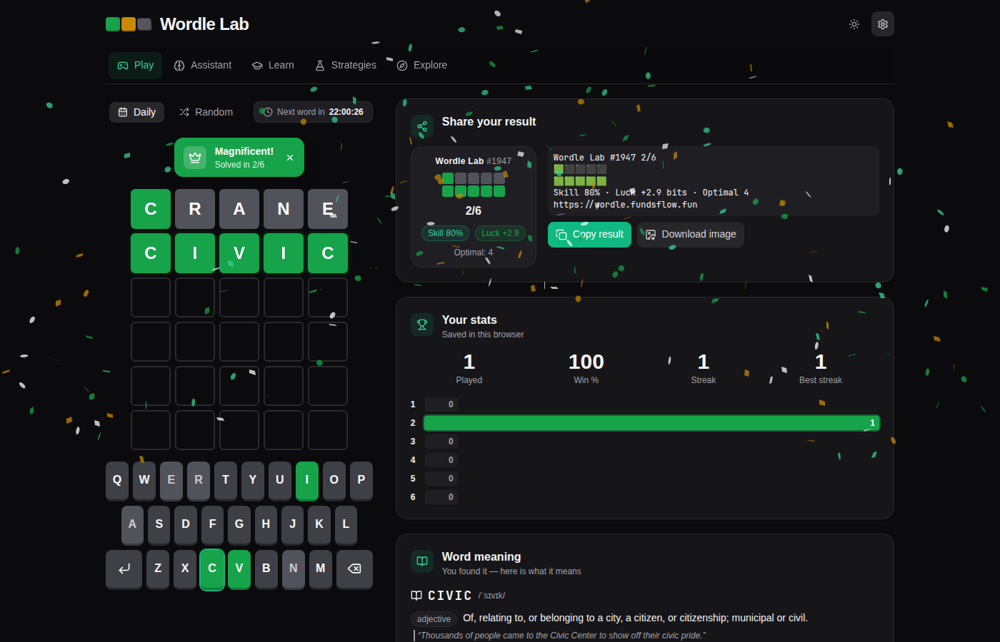

</div>

## ✨ Features

| | |
|---|---|
| 🎮 **Play** | Daily word with a countdown to the next one, or random games. Hard mode, flip/bounce/confetti animations, stats and the **word's meaning**. After each game: a per-guess **review**, **how the optimal strategy solves the same word**, and a **share card** with your skill and luck. Your **player fingerprint** tracks skill and luck over time (stored in your browser). |
| 🧭 **Assistant** | **Help me now:** type your guess, tap the tiles to match your colours, and get the next best word with a plain-language reason (undo, demo, shortcuts, the provably optimal tree). **Review a game:** paste any result, e.g. `ARISE(⬜⬜⬜🟨⬜) CLOTH(⬜⬜🟩🟨⬜)`. **Watch a strategy:** pick a word and a strategy and watch it play. All three use the same per-guess card: bits gained vs expected, the best move by entropy and by the optimal tree, luck, and tips. |
| 🎓 **Learn** | A four-step **guide** (letters → patterns → entropy → trees), letter and positional frequencies, the **top openers**, and the **Word inspector** (all 243 colour patterns of any guess, its entropy and its worst case). The opener-pairs heatmap is under *Advanced*. |
| 🧪 **Strategies** | One **leaderboard** of every strategy on every answer: average, gap to the proven optimum, fail % and worst case, with Normal/Hard/Both. Tick two rows to **Compare** them. The **Strategy Lab** builds a strategy from blocks and saves it for the other views. More charts and Web Worker re-runs (cached in IndexedDB) are collapsed. |
| 🔭 **Explore** | The optimal decision **Tree**, a **Flow** sankey of how the answer set shrinks, and an **Answer map** of how hard each word is. On phones, Tree and Flow switch to list drill-downs. |
| 🇺🇦 **Ukrainian** | EN/UA switch in Settings: the whole interface in Ukrainian, Ukrainian word lists, a ЙЦУКЕН keyboard (ґ, є, і, ї), and every strategy simulated on Ukrainian answers. |
| 📖 **Word meanings** | Click any word for its definition (dictionaryapi.dev with Wiktionary as a fallback; UA words link to Горох, СУМ-20 and sum.in.ua). |

Every tab and sub-view is a real link, e.g. `#tab=explore&view=tree`, so you can open views in new tabs and share them. Links from older versions (`#tab=solver`, `#tab=coach`, `#tab=analytics&view=patterns`, …) redirect to their new places. On phones the five tabs are a bottom bar.

<table>
<tr><td>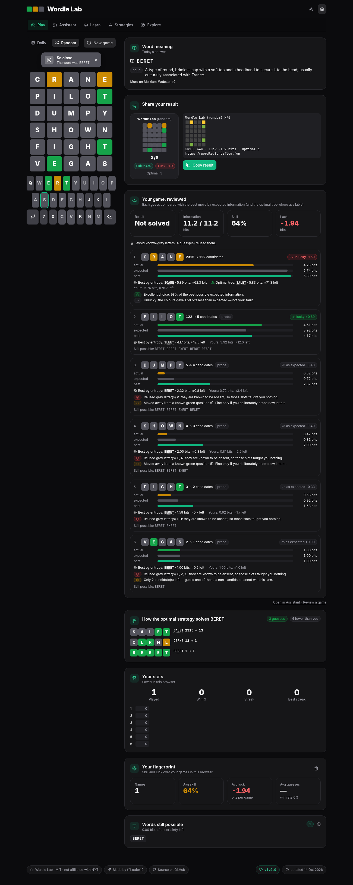</td><td>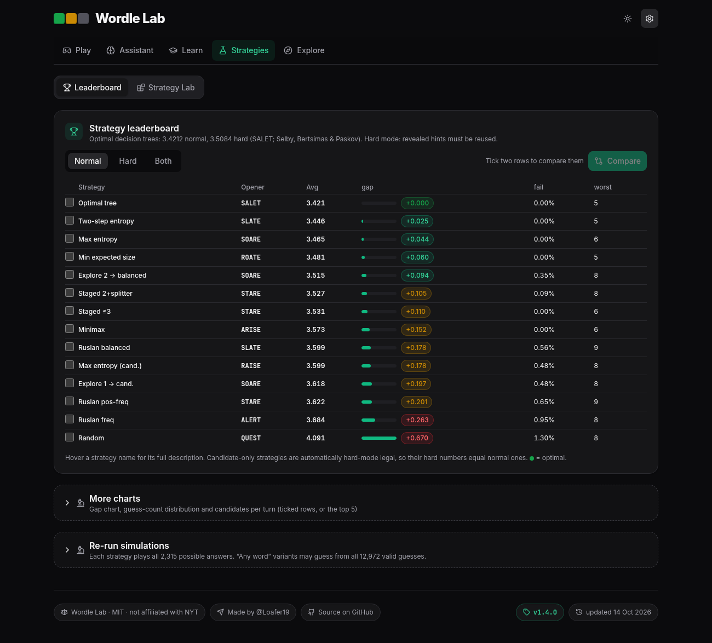</td></tr>
<tr><td>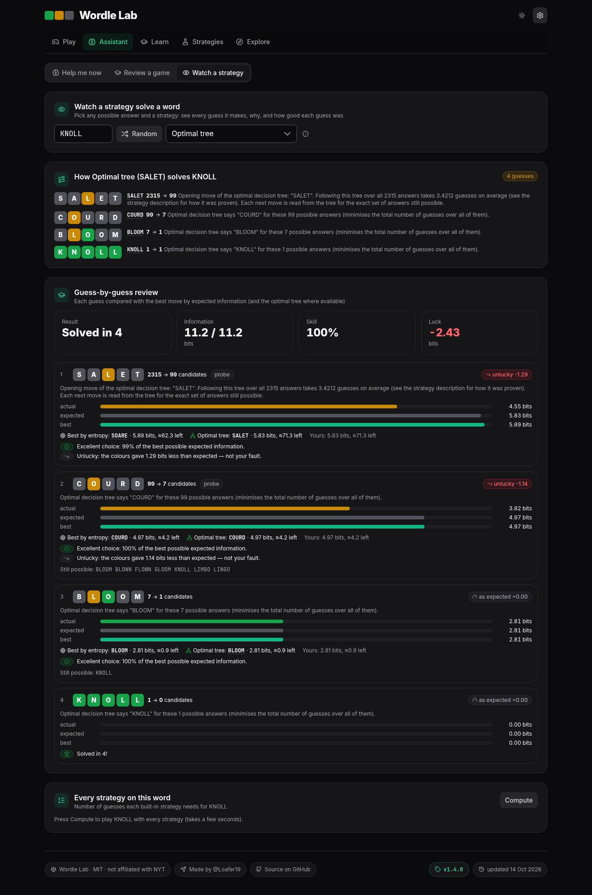</td><td>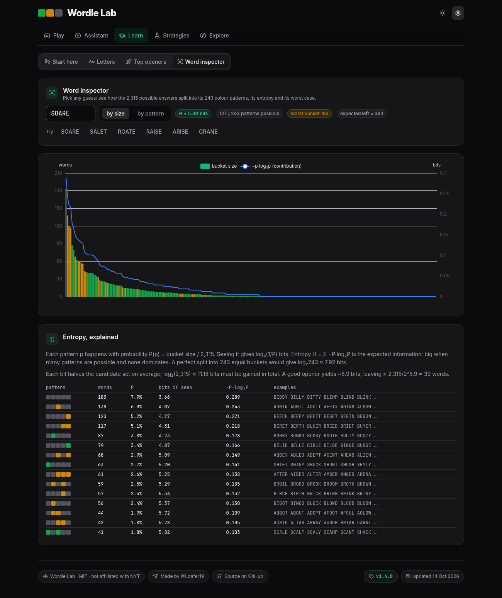</td></tr>
<tr><td>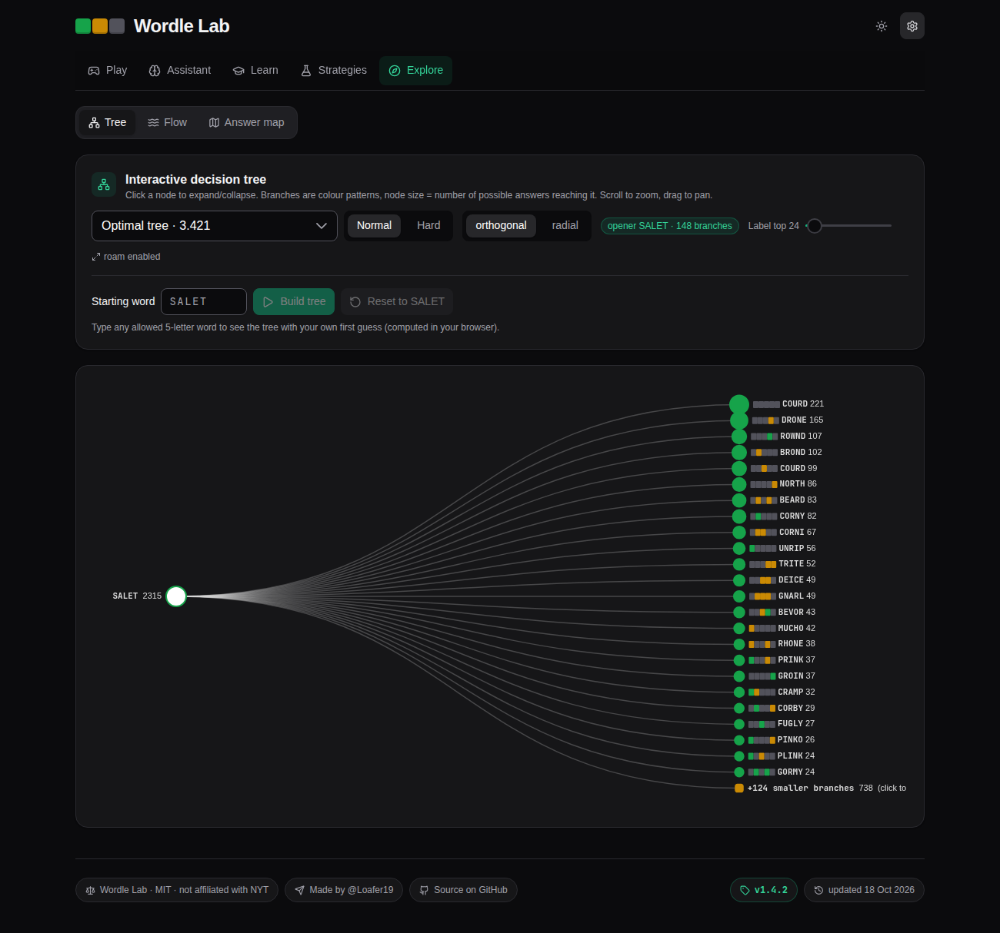</td><td>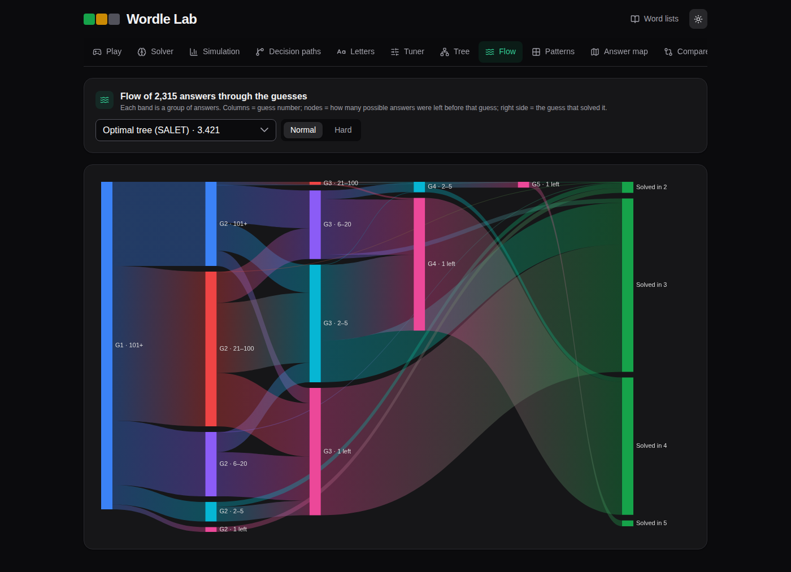</td></tr>
</table>
<p align="center">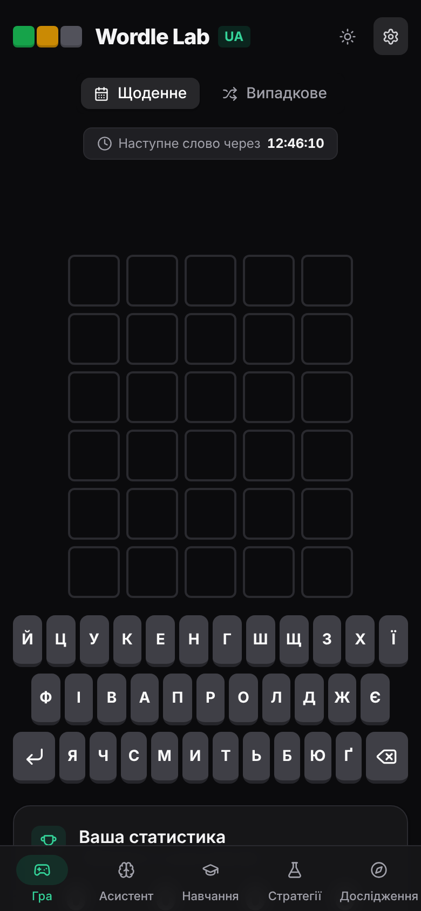 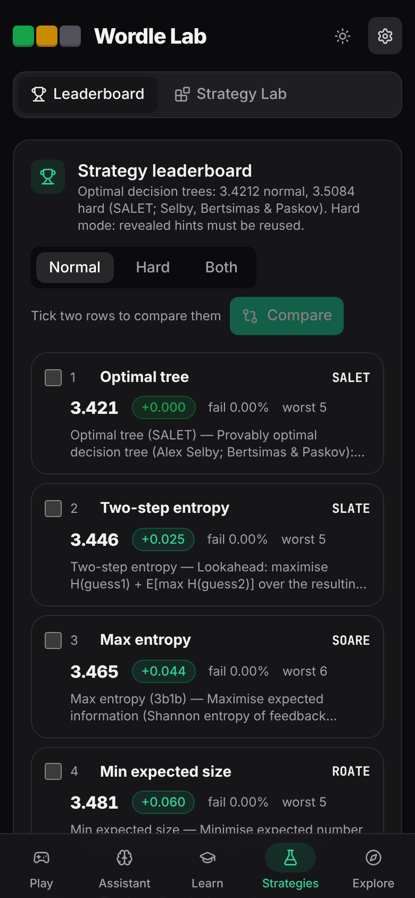 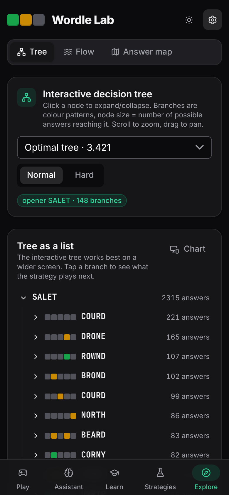</p>

## 🏁 Strategy results

Every strategy plays every answer. *Hard* = Wordle hard mode (revealed letters must be reused, greens stay in place). Fail = needed more than 6 guesses.

### 🇬🇧 English (2,315 answers, 12,972 guesses)

| Strategy | Opener | Normal | Fail | Hard | Fail (hard) |
|---|---|---:|---:|---:|---:|
| **Optimal tree (SALET)** — Selby, proven | SALET | **3.4212** | 0 | **3.5084** | 0 |
| Two-step entropy | SLATE | 3.446 | 0 | 3.553 | 0.30% |
| Max entropy (any word) | SOARE | 3.465 | 0 | 3.603 | 0.30% |
| Min expected size | ROATE | 3.481 | 0 | 3.597 | 0.22% |
| Explore 2 → candidates (Ruslan balanced) | SOARE | 3.515 | 0.35% | 3.632 | 0.65% |
| Ruslan staged (2 coverage turns + cluster splitter) | STARE | 3.527 | 0.09% | 3.629 | 0.52% |
| Ruslan staged (coverage until ≤3 left) | STARE | 3.531 | 0 | 3.646 | 0.65% |
| Minimax worst bucket | ARISE | 3.573 | 0 | 3.676 | 0.65% |
| Ruslan balanced f·(n−f) (candidates) | SLATE | 3.599 | 0.56% | 3.599 | 0.56% |
| Max entropy (candidates) | RAISE | 3.599 | 0.48% | 3.599 | 0.48% |
| Explore 1 → candidates | SOARE | 3.618 | 0.48% | 3.618 | 0.48% |
| Ruslan positional (candidates) | STARE | 3.622 | 0.65% | 3.622 | 0.65% |
| Ruslan freq (candidates) | ALERT | 3.684 | 0.95% | 3.684 | 0.95% |
| Random candidate | – | 4.091 | 1.30% | 4.066 | 1.68% |

Best opener pair: **SLATE + HUMID** (3.633). Regenerate everything with `bun run simulate` (`--lang ua` for Ukrainian).

### 🇺🇦 Ukrainian (1,717 answers, 7,158 guesses)

The UA optima are **our own exact results** (`scripts/ua-optimal/`, a Selby-style exhaustive search in C; proofs modulo 64-bit memo hash collisions):

| Tree | Opener | Total / avg | Worst | Status |
|---|---|---:|---:|---|
| **Optimal tree (UA)** | КОТРА | 5805 / **3.3809** | 6 | proven optimal (only КОТРА reaches 5805) |
| Optimal tree (UA, ≤5 guesses) | КОТРА | 5806 / 3.3815 | 5 | proven optimal under the 5-guess cap; a 4-guess guarantee is impossible |
| **Optimal tree (UA, hard)** | КАРСТ | 5930 / **3.4537** | 7 (2 words) | proven optimal average in hard mode; 117 other openers can only tie (bound 5930) |

| Strategy | Opener | Normal | Fail | Hard | Fail (hard) |
|---|---|---:|---:|---:|---:|
| **Optimal tree (UA)** / **(UA, hard)** | КОТРА / КАРСТ | **3.3809** | 0 | **3.4537** | 0.12% |
| Optimal tree (UA, ≤5 guesses) | КОТРА | 3.3815 | 0 | – | – |
| Max entropy (any word) | КОТРА | 3.396 | 0 | 3.488 | 0.29% |
| Min expected size | КОТРА | 3.409 | 0 | 3.503 | 0.29% |
| Two-step entropy | КОТРА | 3.418 | 0 | 3.497 | 0.23% |
| Explore 2 → candidates (Ruslan balanced) | КОТРА | 3.433 | 0.29% | 3.514 | 0.41% |
| Max entropy (candidates) | КОСАР | 3.487 | 0.29% | 3.487 | 0.29% |
| Ruslan staged (2 coverage turns + cluster splitter) | НОРКА | 3.490 | 0.12% | 3.575 | 0.47% |
| Ruslan staged (coverage until ≤3 left) | НОРКА | 3.493 | 0 | 3.643 | 1.28% |
| Explore 1 → candidates | КОТРА | 3.493 | 0.35% | 3.493 | 0.35% |
| Minimax worst bucket | КРОНА | 3.502 | 0 | 3.569 | 0.58% |
| Ruslan positional (candidates) | НОРКА | 3.551 | 0.52% | 3.551 | 0.52% |
| Ruslan balanced f·(n−f) (candidates) | НОРКА | 3.593 | 0.93% | 3.593 | 0.93% |
| Ruslan freq (candidates) | АКТОР | 3.649 | 0.76% | 3.649 | 0.76% |
| Random candidate | – | 4.134 | 2.27% | 4.070 | 1.75% |

Gap tables in the app compare each language with its own optimum (EN 3.4212 / 3.5084, UA 3.3809 / 3.4537).
How much the second guess matters: [docs/analysis-second-step.md](docs/analysis-second-step.md) (scripts in `scripts/analysis/`).

## 🎓 Game review & fingerprint

After every Play game (daily or random, EN and UA) each guess is reviewed: candidates before → after, the bits you actually gained versus the bits that guess was expected to give, the best guess by entropy (hard-mode legal in hard mode) and the optimal-tree move while you are still on the tree, a luck indicator, and short tips (reused grey letters, a yellow letter put back in the same spot, cluster traps, when a non-candidate would have helped). Below it, the optimal strategy plays the same word, and the share card adds your **skill** (the share of the best expected information your guesses achieved) and **luck** (bits gained minus bits expected). Every finished game feeds your **fingerprint**: average skill and its trend, average luck, average guesses, and the strategy whose average is closest to yours. *Assistant › Review a game* does the same for any game you paste.

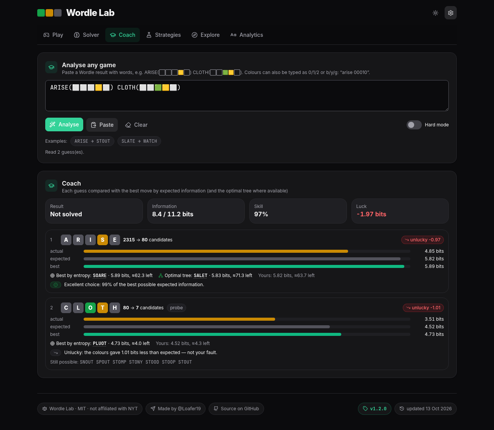

## 🧮 How it works

Each guess *g* splits the remaining answers *S* into up to 3⁵ = 243 colour patterns *p*. If *Sₚ* is the group of answers that would show pattern *p*, then

$$P(p) = \frac{|S_p|}{|S|}, \qquad H(g) = -\sum_{p} P(p)\,\log_2 P(p)$$

*H(g)* is the expected information in **bits**. Seeing pattern *p* gives log₂(1/P(p)) bits, and identifying one answer among the 2,315 takes log₂ 2315 ≈ 11.18 bits. A guess that splits *S* evenly gets close to the ceiling of log₂ 243 ≈ 7.92 bits.

* **Entropy** picks the guess with the highest *H*. **Two-step** adds the expected entropy of the best follow-up guess in each group.
* **Minimax** minimises maxₚ |*Sₚ*|. **Expected size** minimises Σ |*Sₚ*|² / |*S*|.
* **Letter frequency**: if *f* is the number of candidates containing a letter and *n* the number of candidates, the balanced score is *f·(n−f)*. It rewards letters that split the candidates roughly in half.
* **Optimal** follows a precomputed decision tree that minimises the total number of guesses over all answers. It is verified on load, and if your guesses leave the tree it falls back to two-step.

Feedback is encoded in base 3 (gray 0, yellow 1, green 2), so 242 means all green. Duplicate letters are handled exactly as Wordle does.

## 🚀 Run it

```bash
bun install
bun run dev          # http://localhost:5173
bun run build        # static site in dist/
bun run simulate     # recompute public/sim/*, results.json, optimal tree, opener pairs
bun run test:unit    # engine, coach, routes/redirects, fingerprint
bun run test:e2e     # Playwright regression tests against the dev server (needs Chrome; CHROME=/path, BASE_URL=… to override)
bun scripts/i18n-check.ts           # every UI string has a Ukrainian translation
OUT=shots bun scripts/shots.ts      # screenshots of every view (EN/UA × desktop/390px) + overflow/console check
bun run definitions  # optional: precompute word meanings into data/ and public/
```

Docker: `docker build -t wordle-lab . && docker run -p 8080:80 wordle-lab` (Bun build, served by Caddy).

## 🙏 Credits & data

* **Word lists:** original Wordle answers (2,315) and allowed guesses (10,657 extra) from [cfreshman's gists](https://gist.github.com/cfreshman/a03ef2cba789d8cf00c08f767e0fad7b) ([allowed](https://gist.github.com/cfreshman/cdcdf777450c5b5301e439061d29694c)). The gists have no license; they are reproduced with attribution.
* **Optimal trees:** [alex1770/wordle](https://github.com/alex1770/wordle) by Alex Selby, MIT License © 2022 Alex Selby.
* **Ukrainian words:** [kobzaapp/kobzadict](https://github.com/kobzaapp/kobzadict), filtered from [VESUM / brown-uk](https://github.com/brown-uk/dict_uk) (CC BY-NC-SA 4.0, so the UA data is non-commercial), with answers ranked using [hermitdave/FrequencyWords](https://github.com/hermitdave/FrequencyWords) (CC BY-SA 4.0).
* **Definitions:** [Free Dictionary API](https://dictionaryapi.dev) and [Wiktionary](https://en.wiktionary.org) (CC BY-SA 4.0).
* **Inspiration:** 3Blue1Brown's *Solving Wordle using information theory*; *An Exact and Interpretable Solution to Wordle* by Bertsimas & Paskov.
* Built with Vue 3, Vite, Tailwind CSS v4, PrimeVue 4 (MIT), Apache ECharts, VueUse, Lucide and canvas-confetti.

Wordle is a trademark of The New York Times Company. This is an unaffiliated fan and research project.

## 📄 License

[MIT](LICENSE) © 2026 Ruslan Popelyshyn
